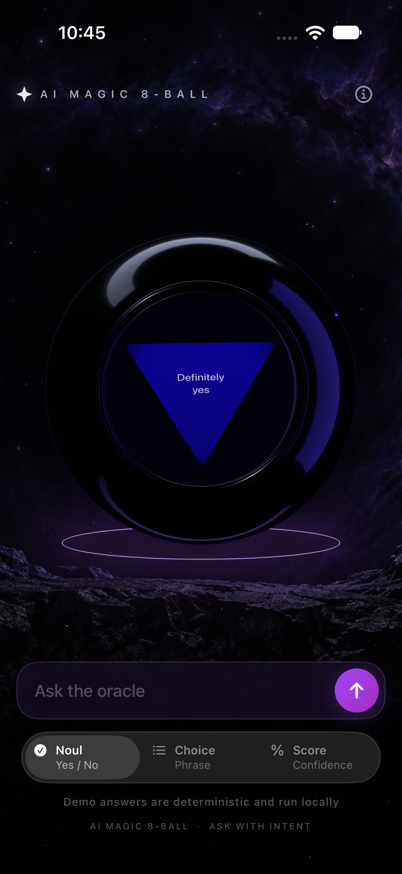

# SwiftDecision Examples

Small applications that demonstrate model decisions composed with `SpecificationCore` rules.

## OracleBallApp

Oracle is a free reference app for SwiftDecision and SwiftJev, with domain policies built on SpecificationCore. See the [product roadmap](DOCS/ORACLE_PRODUCT_ROADMAP.md) and [v1 release readiness](DOCS/ORACLE_V1_RELEASE_READINESS.md) for the first free release; optional paid customization is deferred.

OracleBallApp is an iOS 26 SwiftUI and RealityKit Magic 8 Ball rendering demo.
It supports offline answer simulation and optional inference providers while
keeping the rendering boundary independent from model execution. The scene uses
procedural geometry, a depth-layered open shell, a textured triangular answer
plate, and a custom Metal absorption effect. See
[`DOCS/ORACLE_RENDERING.md`](DOCS/ORACLE_RENDERING.md) for the scene ownership,
run instructions, lifecycle, geometry, material limits, and validation record.



Open `CityChainApp.xcodeproj`, select the **OracleBallApp** scheme, and run on
an iOS 26+ simulator or device. Use the arrow to replay; the engine infers
whether the question needs a Noul, Choice, or Score answer. No API key is needed
for the offline fixture.

The [Duo layout pilot](DOCS/ORACLE_DUO_LAYOUT_PILOT.md) adds adaptive single-pane,
expanded, book, and tabletop arrangements selected by SpecificationCore. It is
disabled by default; enable `ORACLE_DUO_LAYOUT_PILOT=1` in the OracleBallApp scheme
to try it with Xcode 27.1.

Use the share button in History or an entry's Decision pipeline to export saved
questions and traces as JSON or readable text. See
[`DOCS/ORACLE_HISTORY_EXPORT.md`](DOCS/ORACLE_HISTORY_EXPORT.md) for the format,
precision and backward-compatibility contract.

GLiNER adds explicit **Jev / GLiNER small / None** provider selection. Oracle requests its separately provisioned model through Apple-Hosted Background Assets after an explicit install action; developer folder import remains available. No weights are bundled and local inference never falls back to a cloud provider. See [delivery setup and validation notes](DOCS/EXPERIMENTS/GLINER_ORACLE_PILOT.md).


## City Chain

See the [City Chain roadmap](DOCS/CITY_CHAIN_ROADMAP.md) for Scout and the searchable City atlas, and the [adaptive layout specification](DOCS/CITY_CHAIN_ADAPTIVE_LAYOUT_SPEC.md) for iPad and iPhone Duo implementation requirements. The [iPhone Duo design concepts](DOCS/DESIGN/CITY_CHAIN_DUO_CONCEPTS.md) contain illustrative layouts and deferred proposals.

City Chain is an offline-testable game engine for a US cities word chain. The player may enter any city name; Noul checks whether it is a US city. The built-in catalog supplies computer replies and the searchable City atlas, with the 50 state capitals plus 100 additional cities. Search matches the beginning of a city name (for example, Y finds Yuma and Yonkers). The atlas highlights cities available for the current turn and copies a selected name into the composer without sending it.

The app uses `CityContinuationPolicy.previousAvailableLetter`: when no unused catalog city starts with the last letter, a Core decision specification scans the preceding letters of that name from right to left. The same rule applies to the player and Scout. If no letter has candidates, the next turn allows any unused city. The route and turn prompt explain skipped letters. The engine defaults to `.lastLetter` for existing clients; exhausting the entire reply catalog still completes the trip positively. See [catalog sources](DOCS/CITY_CATALOG_SOURCES.md) for the 50 newly added cities.

The engine composes Core rules to reject empty input, enforce the current starting letter, prevent reuse, filter computer replies, and route between no reply, one automatic reply, and a model-selected reply. SwiftDecision uses Noul for player-city validation and Choice to select among at most five legal candidates, taken in stable catalog order. If Choice inference fails, the engine randomly selects from those same candidates. Noul abstentions remain visible as game outcomes, while Noul errors still propagate without partially committing a turn.

The game engine has no UI or live model requirement, so its rule combinations run offline with a deterministic request/response backend:

```sh
swift test
```

The engine package supports iOS 15+ and macOS 10.15+. A SwiftUI example app can use it as its domain layer.

## Optional TypeSafe Jev backend

The pilot pins SwiftDecision to the implementation revision in [PR #23](https://github.com/SoundBlaster/SwiftDecision/pull/23), alongside [SwiftJev 0.5.0](https://github.com/SoundBlaster/SwiftJev/releases/tag/0.5.0) and [SpecificationCore 2.1.0](https://github.com/SoundBlaster/SpecificationCore/releases/tag/2.1.0). This is not a SwiftDecision release update. The game remains offline by default; choose the hosted provider explicitly through `CityChainBackendFactory` when a caller has configured a key:

```swift
let backend = try CityChainBackendFactory.makeJev(apiKey: apiKey)
let game = CityChainGame(decisions: DecisionEngine(backend: backend))
```

`makeJev` performs configuration validation and does not send a request during initialization. Keep the API key outside source control and inject it from the app's development or deployment secret configuration. The existing SwiftUI app uses the offline backend until its `AppDependencies` is constructed with a live backend.

OracleBallApp exposes the same opt-in path through `JevOracleBackend` while keeping
the `OracleGameEngine` API unchanged:

With the default `.automatic` mode, `OracleGameEngine` routes boolean questions
through a Jev-backed intent classifier. The classifier selects Noul for yes/no
questions, Score for likelihood questions, and Choice only when the question
contains explicit alternatives. Choice options are extracted from alternatives
such as “tea or coffee” or “tea, coffee, or juice”, then validated through Core
specifications before the model selects one. The classifier is instructed never
to invent options. Factual, open-ended, malformed, or absurd questions (for
example, “What is the capital of Paris?”) use the distinct Unsupported fallback
with a short varied phrase such as `Who knows?` or `The stars are silent.`;
they do not trigger a fabricated Choice request. Classifier
abstention remains an abstention when fallbacks are disabled. Jev inference is
bounded by one 2.5-second inference budget shared by classification and answer
generation, even when the response keeps delivering bytes. A successful live
classification is retained when answer generation falls back. Timeouts, network
errors, rate limits, and server
failures switch to a clearly identified local offline answer; a 30-second
cooldown prevents repeated waits while Jev recovers. Cancellation, invalid
requests, and permanent provider errors remain errors.

```swift
let backend = try JevOracleBackend(
    apiKey: ProcessInfo.processInfo.environment["TYPESAFE_API_KEY"],
    model: "jev-latest"
)
let oracle = OracleGameEngine(backend: backend)
let outcome = try await oracle.answer(
    for: OracleRequest(question: "Will it work?")
)
```

Initialization only validates configuration. Use an injected `JevHTTPTransport`
for deterministic tests; live calls remain caller opt-in and are never required
by the default build or test suite.

Magic 8 Ball now passes one SwiftDecision `DecisionBudget` through live intent
classification and answer generation using its existing engine. Network and HTTP
classification comes from SwiftJev. The 2.5-second duration, cooldown, selected
intent preservation, SpecificationCore fallback rule and UI lifecycle remain
application policy.
